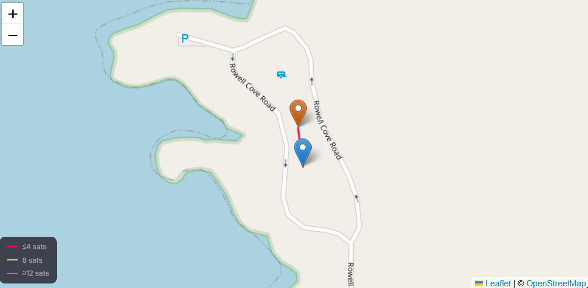
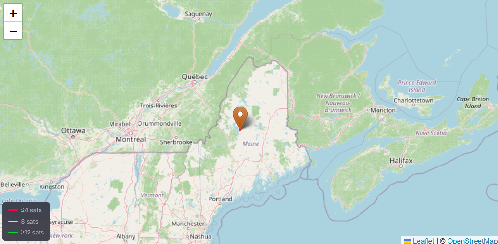

# gps-experiment

I've been using a built-in GPS receiver on one of my handheld amateur radios to track some of my hikes and drives.

The radio records location data to an SD card every 1, 5, 10, 30, or 60 seconds. The data can have sentence types RMC, GGA, VTG, or GSA. These sentence types are defined here: https://gpsd.gitlab.io/gpsd/NMEA.html

To quickly view logs on a map without cleaning up the data, I have been using the online NMEA Log Viewer at https://gnsscalc.com/nmea/

For example, taking a log file that just contains this:

```
$GPGGA,103028.889,4534.7364,N,06933.0322,W,1,03,2.8,29.7,M,-29.7,M,,0000*57
$GPGSA,A,2,11,05,20,,,,,,,,,,4.2,2.8,3.2*39
$GPRMC,103028.889,A,4534.7364,N,06933.0322,W,0.69,114.78,080926,,,A*70
$GPVTG,114.78,T,,M,0.69,N,1.3,K,N*04
$GPGGA,103128.888,4534.7612,N,06933.0368,W,1,04,2.8,28.5,M,-29.7,M,,0000*59
$GPGSA,A,3,21,11,05,20,,,,,,,,,4.2,2.8,3.1*38
$GPRMC,103128.888,A,4534.7612,N,06933.0368,W,0.67,143.39,080926,,,A*73
$GPVTG,143.39,T,,M,0.67,N,1.2,K,A*03
```
Generates two points on a map like this in Lily Bay State Park in Maine:



